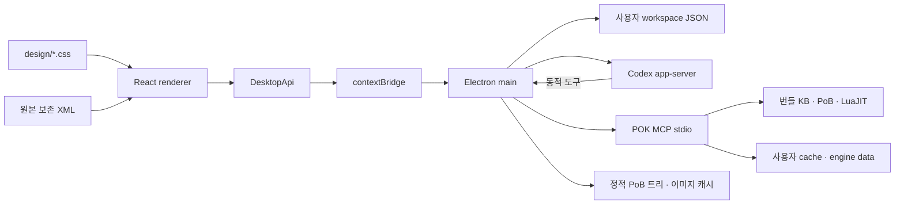

# 구조와 배포 경계

21차: `tree-adopt-legacy`는 단일 root Spec/Tree 부재를 검증해 동일한 DOM 노드를 원래 위치의 Tree 아래로 옮긴다. native 요청은 정규화 전 원문을 로드하고 `adopt`로 원본 복원 후 Save의 known state를 전달한다. host가 검증한 source ID1을 native lineage에 연결하며 loadoutEdit는 구조 이동→clone/placement→known-state 패치→identity 순으로 적용한다. raw의 선언 버전을 UI가 모델 버전으로 추정하지 않는다. NativeTreeWorkspace의 adopt 검토는 버전/직업 선택과 분리하며, unknown metadata와 원문/undo를 보존한다. 혼합/다중 입력은 임의의 첫/마지막 spec을 선택하지 않고 거부한다.

20차: readLoadouts의 선택 treeWorkspace 요청은 원본 versionSelect/Convert popup/ConvertAll 및 초기 spec의 class/ascend/name 컨트롤을 replay한다. main은 canonical set ID 목록을 XML에서 산출해 내부 요청에만 공급하고 요청 echo를 키 순서와 무관하게 검증한다. 원본 객체 lineage로 converted spec의 source/copy를 추적하고 native Save의 알려진 상태를 treePatches로 전달한다. loadoutEdit는 canonical clone/placement 후 패치하며 replaceState는 원본에 없는 기존 소켓을 비우면서 unknown metadata를 보존한다. 초기 빈 섹션은 자기 자신을 set으로 취급하지 않는다. 생성 가능 여부는 계산 가능한 기존 트리와 분리하고, root Spec은 별도 진단/거부로 보호한다. NativeTreeWorkspace는 선택지·XML 차이·검토/취소·revision 적용·새 계산/receipt만 담당한다.

독립 tree 변환은 원본 PassiveTree가 읽는 `TreeData/<version>/tree.lua`를 native `tree-source` 요청으로 export한다. build-time `PobRuntime.treeSource`만 사용하며 renderer IPC에는 노출하지 않는다. 구버전 tree.json에 없는 nodeOverlay 등을 추정/복제하지 않는다. 변환 manifest는 원본 Lua/input 파일 hash, canonical export hash와 converter hash를 구분한다. 이전 converter의 검증된 이미지 캐시는 재사용할 수 있지만 export/입력/converter가 모두 일치해야 전체 tree cache를 재사용한다. renderer는 클래스/전직의 array·record 표현을 읽고 overlay 부재로 전체 화면이 중단되지 않게 한다.

19차(2026-11-03): scope=tree/treeId는 원본 PassiveSpecListControl의 named Popup 및 버튼/drag를 replay한다. stock copy의 새 spec은 원본 객체 lineage로 canonical XML을 복제하고 New만 fresh Save 노드를 쓴다. 신규/복사는 원본처럼 활성 actor를 유지한다. 공통 sets patch는 unchanged kind를 건너뛰고 known set의 DOM 슬롯만 교체해 unknown 형제/legacy 섹션/누락 flag를 보존한다. NativeTreeSets가 기존 TreeView 메뉴 안에서 자동 preview의 form signature/generation 및 revision/runtime을 검증하고 explicit apply·calc·receipt를 담당한다.

18차(2026-11-03): tree scope reorder는 원본 PassiveSpecListControl/ListControl의 드래그 입력과 OnOrderChange를 호출한다. 현재 actor를 title로 다시 찾지 않으며 네 활성 세트/주력/무기를 보존했는지 검사한다. metadata의 treePositions/treeAssociations를 한 번만 전달해 위치/공유 관계를 renderer가 추론하지 않게 한다. movement는 source/destination spec 위치·영향받는 원본 이름·activePreserved를 기록한다. canonical DOM lineage를 재배치하고 revision에 속한 새 계산으로 확인하며, 단순 위치 remap을 활성 구성 전환으로 표시하지 않는다.

17차(2026-11-03): native 관리 metadata는 원본 목록 index 또는 원본이 제공한 sourceName 및 동작별 capability를 반환한다. named delete는 사용자 지정 nextName을 원본 API로 재조회/선택하고 실제 생존 객체의 동일성을 검증한다. 원본 구성의 객체 관계 전후 차이는 native에서 계산하며 UI는 결과를 표시한다. 적용 계산의 workspace_operation은 입력 revision/hash·검토 runtime·요청/선택·연결 변화만 자동 저장하며 개인 XML을 중복 저장하지 않는다. renderer는 brace/게임 규칙을 구현하지 않는다.

16차(2026-11-03): loadout-management.lua는 원본 관리 컨트롤을 replay하고 Copy API의 객체 출처를 기록한다. native 관리 목록의 실제 순서를 보존하기 위해 Loadout은 명확한 active set 검증 후 canonical raw XML을 로드한다. `loadout-native-sets` 패치는 기존 노드를 유지/복제하고 새 노드만 원본 Save JSON으로 생성한다. 부모 섹션·공유 item library·unknown 필드는 재생성하지 않는다. 모든 변경/제거는 검토와 revision 검사를 거쳐 적용되며 취소/오류는 격리 요청 안에 머무른다.

15차(2026-11-03): loadouts.lua는 원본 Build의 목록/이름·식별자 해석/동시 전환을 호출한다. main은 projectActiveXml의 spec 위치를 canonical 위치로 역매핑하고 입력/출처를 응답에 붙인다. `loadoutEdit`는 원본이 반환한 네 세트·직업·무기/주력 그룹만 원자 패치한다. renderer는 변경을 검토하고 explicit apply 후 새 계산하며, 요청별 취소·revision/XML/runtime/name 검사로 늦은 결과를 차단한다. Loadout 관리 CRUD/Custom/Reorder는 아직 별도 미구현이다. 새로운 매칭·게임 규칙을 renderer에 만들지 않는다.

14차(2026-11-03): `resolveTreeSetEdit`는 prospective XML을 기존 원본 tree 조회에 보내 직업/전직을 확인하고, 세트 변경+Build identity를 하나의 XML revision으로 반환한다. renderer는 게임 ID→직업 매핑을 추정하지 않는다. `useTreeSetEdits`는 응답 소유·문서 세대·runtime을 검증하고 취소/문서 전환의 늦은 결과를 버린다. 비교의 optional treeIdentity는 원본 조회값만 보관하며 `projectComparisonSide`가 측정 XML을 재구성한다. 적용 직전 원본 재조회/측정 hash/현재 revision이 일치해야 한다. 과거 비교 형식은 보존하며 직업 정보가 달라진 기록은 재비교가 필요하다.

13차(2026-11-03): tree 어댑터는 원본 Build classDrop/ascendDrop 콜백을 호출한다. 원본 확인창의 reset/connect 선택을 요청/미리보기 계약으로 전달하며, 원본 PassiveSpec의 연결/재설정 결과와 Build.Save의 className/ascendClassName만 패치한다. renderer는 원본 선택지·diff를 표시하고 revision/runtime 확인 후 명시 적용·재계산한다. 문서 전환/취소의 미리보기는 canonical XML에 영향을 주지 않는다.

12차(2026-11-03): item-controls 어댑터는 원본 제작 affix 선택·tier slider와 일반 modifier range 선택/slider를 호출한다. 원본 ItemsTab.Save가 만든 variant/ModRange를 `item-native` XML 부분 패치로 전달한다. unknown metadata는 유지하며 제거가 필요한 unknown range는 적용을 차단한다. 접사 키는 여러 원본 tier ID를 포함하므로 host는 16KiB 전송 한도만 두고 원본이 선택/입력 유효성을 검사한다. tier 수식·접사 배타 규칙은 renderer에 구현하지 않는다.

## 독립 실행 구현 진행 — 2026-11-02

11차: equipment.lua는 원본 orderedSlots/Populate/ReceiveDrag/weaponSwap callback을 실행한다. native 전/후 active ItemSet/Build 상태 차이만 equipment-native-patch로 반영해 관련 슬롯 정리와 주력 스킬 변경을 놓치지 않는다. useEquipmentState는 exact XML/revision/runtime에 속한 동적 슬롯만 현재 데이터로 사용하며, 현재 XML과 원본 복원 슬롯의 차이는 별도 진단한다. 장착/전환 후 새 계산도 제출 snapshot에만 귀속된다.

10차: item-popups는 잠시 OpenPopup을 래핑해 원본 컨트롤을 확보하고 원래 OpenPopup/ClosePopup 및 callback을 실행한다. NotableDB/ListBuilder와 원본 corruption 그룹/slider 계산을 재사용하며, 새 요청마다 상태를 재생한다. 결과는 detached draft로만 돌아온다. requestId 취소는 runtime queue/active child의 해당 작업만 취소하며 global generation 종료와 구분한다. renderer가 닫힌 뒤 취소/오래된 응답을 적용하지 않는다.

9차: item-controls는 복원된 Item.BuildRaw로 분리한 Item에 원본 SetDisplayItem/컨트롤 callback을 실행하고 fields/선택지/파싱 진단을 반환한다. 원본 sanitiseText 대응만으로 비ASCII 원문을 보존하며, 복원이 불확실한 결과는 적용을 막는다. renderer는 original/draft/입력 revision/runtime/item/slot을 확인하고 applyExpected 후 새 계산한다. receipt에는 native editor 진단을 붙인다. 저장 목록 장착도 원본 슬롯 검증 receipt가 있어야 진행한다. renderer에 소켓/룬/장착/번역 규칙을 구현하지 않는다.

8차: tree action attribute/jewel은 원본 SwitchAttributeNode/ItemSlotControl과 slot.Populate의 결과를 사용한다. 주얼 patch는 native Save 전/후 sockets 차이를 대상으로 하고, 새로운 AttributeOverride는 native Save의 완전한 필드 그룹을 전달한다. XML 무기 목록은 렌더링 metadata로만 읽으며 경로/장착 판단은 원본에 남긴다. editor.load는 원본 ShowErrMsg를 수집해 로드 실패가 빈 기본 빌드의 성공 계산으로 넘어가지 않도록 한다.

7차: `tree.lua`는 원본 PassiveSpec의 전/후 Save 결과 차이로 native 패치를 만든다. main의 `tree` 요청은 입력·runtime을 확인하고 같은 요청을 병합, 더 최신 선택으로 대체된 응답을 거부한다. `useTreeOperation`은 선택·revision·XML·모드가 일치하는 결과만 적용 가능하게 하며 canvas는 원본이 반환한 변경 ID만 강조한다. `tree-native-patch`는 변경된 알려진 필드만 XML DOM에 반영한다. 경로·종속성·무기 모드·능력치 override 계산은 원본에 남는다.

6차: `party.lua`는 원본 PartyTab의 출력 생성·Import/Clear callback·버퍼 요약을 읽는다. 지원 빌드와 대상 XML은 작업 프로세스에만 로드하며 원본 파일을 쓰지 않는다. `PobRuntime.party`는 두 XML의 hash/대상 revision/runtime을 돌려준다. `PartyView`는 native 결과를 미리보고 대상 id/revision/XML을 확인해 지정 버퍼 편집으로 적용한 뒤 재계산한다. 원본 파티 병합/해석 규칙은 JS로 옮기지 않는다. 일시적 disable/rebuild의 독립 요청 간 상태 계약은 별도로 남겨 둔다.

5차: `runtime/pob/calcs.lua`는 원본 계산 섹션의 가용성을 CheckFlag로 평가하고 원본 formatCalcStr/CalcBreakdownControl로 표시값과 분해를 만든다. `PobRuntime.calcs`는 id/revision/XML hash/runtime/시각을 부여하고 같은 입력을 병합·낡은 대기를 거부한다. `CalcsView`는 현재 입력과 일치할 때만 조작·분해 조회를 허용하고 모달을 닫거나 입력을 바꾼 뒤 늦게 온 응답을 표시하지 않는다. 원본 Calcs 입력/스킬 전용 필드는 XML 대상 편집으로 보존하며 MAIN 계산과 XML 저장 PlayerStat는 별도로 표시한다.

4차: `build-history`는 XML 편집/undo/redo를 모두 증가하는 revision으로 기록하고 새 분기 편집 시 redo를 폐기한다. `build-management`의 폴더와 보관함은 작업 공간 metadata이며 원본 파일 작업을 하지 않는다. `build-comparison`은 제출 XML snapshot/세트 선택/계산 receipt를 저장하며, `build-changes`를 AI 제안과 일반 수동 비교에서 공유한다. 적용은 최신 문서와 id/revision/XML을 동기 확인하고, 측정 receipt의 입력 hash/runtime을 확인한 다음 새 계산한다. 늦은 응답은 변경된 현재 문서에 붙이지 않는다. StateStore는 보관함·폴더·비교 기록과 참조 XML/세트의 유효성을 검사한다.

3차 구현: `PobRuntime.inspect`가 실제 XML을 원본 PoB에 로드한 뒤 조건의 분류/가용성/기본값/리스트/설명과 스킬 선택 컨트롤을 읽는다. renderer는 게임 조건 판정을 복제하지 않는다. 응답은 buildId/revision/XML hash/runtimeId에 귀속되고 같은 입력 요청은 병합, 대기 중 낡은 조회는 대체한다. UI는 이전 구조를 표시하더라도 현재 입력 검증 전에는 해당 선택을 잠근다. 클래스 표시도 현재 원본 조회를 사용한다.

4종 세트 CRUD와 노트는 XML DOM의 대상 요소만 편집하며 비활성 세트/알 수 없는 필드를 보존한다. legacy 평면 형식은 알려진 세트 소유 요소만 wrapper로 이동하고, 트리는 위치 기반 activeSpec을 재계산한다. 모든 편집 화면의 임시 입력은 문서별 컴포넌트 수명에 격리한다.

2차 구현에서 `PobEditorData`를 추가해 catalog/tree/image/new-build/item-render IPC를 PoK에서 분리했다. `resources/pob-editor`는 원본 metadata/직업/접사/젬·스킬/유니크와 파생 트리를 가지며, 모든 파일 해시와 원본 commit/runtimeId를 검증한다. 실제 생성은 원본 PoB Item/Craft 객체에 위임한다. UI에서 접사 수치·게임 규칙을 계산하지 않는다. `pob:prepare-data`의 Python은 이미지 변환 빌드 도구이고 앱의 실행 의존성이 아니다.

배포 기본 리소스는 `pob-runtime`+`pob-editor`이고 `verify:pob`가 두 출처/트리를 검증한다. PoK bundle은 필수 배포 입력에서 제외했다. 실제 패키지 검증과 선택 PoK/AI의 context 분리는 아직 진행 중이다.

수동 계산 IPC는 이제 `PobRuntime`으로 원본 PoB를 직접 실행하며 PoK/KB/Python identity를 요구하지 않는다. `runtime/pob/worker.lua`는 원본 HeadlessWrapper API만 호출하고 게임 계산을 복제하지 않는다. 원본 PoB·LuaJIT·어댑터를 source commit/파일 해시 manifest로 별도 준비하며, 요청마다 독립 프로세스와 XML을 로드한다. 새 계산 provenance는 `runtime:'pob'`와 독립 runtimeId를 갖고 PoK source/KB digest를 꾸며 넣지 않는다.

PoK 자동 연결은 명시적인 `settings.pok.autoConnect:true`일 때만 수행한다. 미설정/기본값은 연결하지 않음이다. 선택 연결의 버전 실패가 독립 계산 결과를 무효화하지 않는다. 수동 계산과 선택 연결의 출처는 별도다.

이것은 전체 독립 편집기 완료가 아니다. 원본의 모든 편집·비교·관리 기능과 실제 portable 검증을 계속 수행해야 한다. 다음 작업과 전체 기능 대응표는 [POB-STANDALONE-PLAN.md](POB-STANDALONE-PLAN.md)를 따른다. 아래 10월 구조 설명 중 PoK 계산 경로/자동 연결은 당시 구현의 기록으로 읽는다.

## 확정된 제품 요구와 현재 구조의 차이 — 2026-10-30

- pok-ui와 PoK는 **각각 독립 실행**해야 한다. pok-ui의 PoB 수동 편집·계산·저장/복원에 PoK 설치·연결·KB·AI를 필수로 두지 않는 것이 목표다. PoK의 기존 독립 사용도 유지한다.
- PoK 연결은 편집기 완성 이후의 선택 기능이다. 연결 시 UI 쪽 PoB와 PoK 쪽 PoB의 버전/commit·출처를 비교하고, 호환 여부·불일치의 영향과 가능한 동작을 명시해야 한다. 미연결 상태와 버전 불일치는 별도 상태다. 한쪽을 몰래 갱신하거나 불일치한 결과를 같은 기준의 계산으로 섞지 않는다.
- 아래 그림과 본문은 **현재 구현**이다. 실제 코드의 `GameDataStore`, `verifiedContext`, `PokConnection.compute`, `render_pob_item` 및 renderer의 연결/카탈로그 gate는 PoK bundle/연결과 결합되어 있다. 독립 실행 요구를 충족했다고 간주하지 않는다.
- 독립 PoB 백엔드의 소유·배포·공유 방법과 API는 아직 설계하지 않았다. PoK 분리 요구가 PoB 계산기 자체의 불필요함을 뜻하지 않는다. renderer/main에 Lua·게임 규칙·별도 계산 경로를 즉석 구현하거나 이번 세션에서 엔진 소스를 수정하지 않았다.
- 먼저 PoB 기능별 대응표와 결합 지점을 감사하고 독립 실행 구조를 설계한다. [인계와 재개 순서](HANDOFF-20261030.md)의 최신 요구가 과거 AI 우선 작업 순서보다 우선한다.

```text
Documents/
├─ poe2-ai-wiki/          # 별도 Git: KB · MCP · 결정적 계산 · 에이전트 스킬
└─ pok-ui/               # 별도 Git: 데스크톱 UI와 배포
   ├─ src/
   │  ├─ renderer/       # React 화면; 브라우저 API만 사용
   │  │  ├─ design/      # tokens / layout / components CSS
   │  │  ├─ components/ # 공통 능력치 패널
   │  │  ├─ features/   # 장비, 스킬, 트리, 설정, 채팅
   │  │  ├─ state/      # 작업 공간 편집과 저장 큐
   │  │  └─ services/   # DesktopApi 연결과 개발 미리보기 어댑터
   │  ├─ shared/        # 순수 계약, XML 문서 편집, 초기 상태
   │  ├─ preload/       # 제한된 contextBridge API
   │  └─ main/          # 파일 저장, MCP, Codex 프로세스, IPC 검증
   ├─ resources/pok-runtime/ # 생성된 엔진 배포물; gitignore
   ├─ resources/passive-tree/ # PoB 버전별 트리·변환 이미지; gitignore
   ├─ scripts/          # 개발, 빌드, 경계 검사, 런타임 준비
   ├─ tests/            # XML 보존, 저장, IPC·에이전트 동작 검증
   ├─ docs/
   ├─ dist/             # 생성된 앱 코드; gitignore
   └─ release/          # 생성된 실행 파일; gitignore
```



CSS는 데이터 계약과 독립적이다. 화면 컴포넌트를 바꾸더라도 XML 변환, MCP 연결, 파일 저장 구현은 바뀌지 않는다. `check-boundaries.mjs`로 렌더러→main 직접 접근, shared→React/Node 의존, main→renderer 역참조를 차단한다.

패시브 트리 표시는 MCP와 분리된 정적 데이터 경로다. main은 트리 JSON을 일괄 읽고 제한된 이미지 URL을 반환하며, 렌더러는 원본 궤도 좌표와 연결을 Canvas에 그린다. 트리 버전은 빌드 XML과 일치해야 한다. [변환·캐시·렌더링 상세](PASSIVE-TREE.md)

## 문서·계산

`BuildDocument.xml`은 현재 편집 정본, `originalXml`은 가져온 원본이다. XML DOM에서 요청받은 요소만 수정하므로 비활성 세트와 알려지지 않은 속성도 보존한다. 계산에만 `projectActiveXml`을 만들어 선택한 세트를 명시한다. 검증된 묶음의 `compute_pob_xml`에 선택 세트 XML을 직접 전달하고, 복원은 검사/진단에만 사용한다. 적용할 수 없는 검사는 미실행으로 구분한다. PoB 전체 편집·복원 동등성을 주장하지 않는다.

편집마다 revision을 올리고 이전 XML을 최대 30개 저장한다. 계산 결과는 제출 시점 buildId/revision/XML hash와 POK·PoB·KB를 식별하는 bundleId를 갖는다. 늦게 끝난 계산을 다른 편집본의 최신값으로 표시하지 않는다. AI도 `buildId + baseRevision + proposed XML`로 제안하고 검토 이후 적용한다.

## 저장·프로세스

main만 파일과 프로세스에 접근한다. 저장은 검증 후 임시 파일에 flush하고 rename한다. 종료 시 진행 중 저장을 기다린다. 손상 파일은 보존하며 무조건 빈 데이터로 덮어쓰지 않는다. 저장 버전은 `schemaVersion: 1`이며 형식 변경 시 명시적인 migration을 추가한다.

Electron은 sandbox/contextIsolation을 켜고 nodeIntegration을 끈다. preload는 정의된 API만 공개한다. main은 IPC sender·인자·문서 크기를 검사하고 임의 탐색/팝업/권한/다운로드를 차단한다.

엔진은 독립 프로세스이며 배포 실행 파일 위치와 쓰기 데이터 위치를 분리한다. 개발에서는 저장소 Python을 선택할 수 있다. 배포에서는 앱 resources 아래 manifest의 검증된 entrypoint로 portable Python 런타임을 호출하고 외부 Python/LuaJIT 설치를 요구하지 않는다. 앱의 모드별 어댑터가 같은 MCP 계약을 사용한다.

Codex는 설치된 CLI의 app-server 프로토콜을 사용한다. 기존 인증을 CLI가 처리하며 앱은 인증 토큰을 읽거나 저장하지 않는다. thread 재개, 메시지 스트리밍, 취소, 승인, 동적 POK 도구를 연결한다. 지원 스키마는 로컬 CLI가 생성한 protocol로 확인했고 [공식 App Server 문서](https://developers.openai.com/codex/app-server/)를 참고했다. 프로토콜 변경은 `src/main/agent.ts` 어댑터에서 처리한다. Claude 어댑터는 아직 없다.

## 고정 원본 데이터 배포

[데이터 묶음 절차](DATA-BUNDLE.md)를 따른다. `GameDataStore`가 원본 카탈로그·트리·런타임의 출처와 파일 해시를 검증하고, `PokConnection`은 검증된 실행 정보만 사용한다. 원본은 POK runtime에 한 벌이며 UI 카탈로그는 KB와 분리된 원본 추출물이다. 갱신은 빌드 전에만 수행한다.

## 채팅 입력·질문·연결 상태

Codex model/list의 모델·입력 모달리티·추론 강도를 UI에 전달한다. 이미지 원문은 main의 ChatImageStore가 형식/크기/해시를 검사하고 사용자 데이터 아래 보관한다(최대 4개, 개당 4 MiB). 렌더러와 저장 대화에는 경로 대신 불투명 ID와 메타데이터만 전달한다. 미리보기는 제한된 pok-image 프로토콜, 모델 입력은 main이 확인한 localImage 경로를 사용한다.

requestUserInput은 명시적 선택을 받은 뒤 RPC에 답한다. 비동기 질문은 턴 진행 중에는 steer, 종료 후에는 같은 대화의 새 턴으로 전달하며 종료 알림 경합에서도 답변을 보존한다. 취소 실패 시 질문과 실행 상태를 유지한다. 새 메시지에는 완료 시각과 소요 시간을 저장한다.

POK 연결 상태는 main의 실제 MCP 수명에 종속된다. 종료나 RPC 시간 초과는 즉시 연결 해제로 게시한다. 에이전트는 관리되는 동적 도구 브리지를 사용하며 독립 pok MCP 인스턴스는 비활성화한다.
