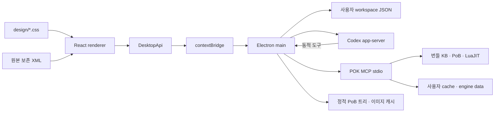

# 구조와 배포 경계

## 확정된 제품 요구와 현재 구조의 차이 — 2026-10-30

- pok-ui와 PoK는 **각각 독립 실행**해야 한다. pok-ui의 PoB 수동 편집·계산·저장/복원에 PoK 설치·연결·KB·AI를 필수로 두지 않는 것이 목표다. PoK의 기존 독립 사용도 유지한다.
- PoK 연결은 편집기 완성 이후의 선택 기능이다. 연결 시 UI 쪽 PoB와 PoK 쪽 PoB의 버전/commit·출처를 비교하고, 호환 여부·불일치의 영향과 가능한 동작을 명시해야 한다. 미연결 상태와 버전 불일치는 별도 상태다. 한쪽을 몰래 갱신하거나 불일치한 결과를 같은 기준의 계산으로 섞지 않는다.
- 아래 그림과 본문은 **현재 구현**이다. 실제 코드의 `GameDataStore`, `verifiedContext`, `PokConnection.compute`, `render_pob_item` 및 renderer의 연결/카탈로그 gate는 PoK bundle/연결과 결합되어 있다. 독립 실행 요구를 충족했다고 간주하지 않는다.
- 독립 PoB 백엔드의 소유·배포·공유 방법과 API는 아직 설계하지 않았다. PoK 분리 요구가 PoB 계산기 자체의 불필요함을 뜻하지 않는다. renderer/main에 Lua·게임 규칙·별도 계산 경로를 즉석 구현하거나 이번 세션에서 엔진 소스를 수정하지 않았다.
- 먼저 PoB 기능별 대응표와 결합 지점을 감사하고 독립 실행 구조를 설계한다. [인계와 재개 순서](HANDOFF-20261030.md)의 최신 요구가 과거 AI 우선 작업 순서보다 우선한다.

```text
Documents/
├─ poe2-ai-wiki/          # 별도 Git: KB · MCP · 결정적 계산 · 에이전트 스킬
└─ pok-ui/               # 별도 Git: 데스크톱 UI와 배포
   ├─ src/
   │  ├─ renderer/       # React 화면; 브라우저 API만 사용
   │  │  ├─ design/      # tokens / layout / components CSS
   │  │  ├─ components/ # 공통 능력치 패널
   │  │  ├─ features/   # 장비, 스킬, 트리, 설정, 채팅
   │  │  ├─ state/      # 작업 공간 편집과 저장 큐
   │  │  └─ services/   # DesktopApi 연결과 개발 미리보기 어댑터
   │  ├─ shared/        # 순수 계약, XML 문서 편집, 초기 상태
   │  ├─ preload/       # 제한된 contextBridge API
   │  └─ main/          # 파일 저장, MCP, Codex 프로세스, IPC 검증
   ├─ resources/pok-runtime/ # 생성된 엔진 배포물; gitignore
   ├─ resources/passive-tree/ # PoB 버전별 트리·변환 이미지; gitignore
   ├─ scripts/          # 개발, 빌드, 경계 검사, 런타임 준비
   ├─ tests/            # XML 보존, 저장, IPC·에이전트 동작 검증
   ├─ docs/
   ├─ dist/             # 생성된 앱 코드; gitignore
   └─ release/          # 생성된 실행 파일; gitignore
```



CSS는 데이터 계약과 독립적이다. 화면 컴포넌트를 바꾸더라도 XML 변환, MCP 연결, 파일 저장 구현은 바뀌지 않는다. `check-boundaries.mjs`로 렌더러→main 직접 접근, shared→React/Node 의존, main→renderer 역참조를 차단한다.

패시브 트리 표시는 MCP와 분리된 정적 데이터 경로다. main은 트리 JSON을 일괄 읽고 제한된 이미지 URL을 반환하며, 렌더러는 원본 궤도 좌표와 연결을 Canvas에 그린다. 트리 버전은 빌드 XML과 일치해야 한다. [변환·캐시·렌더링 상세](PASSIVE-TREE.md)

## 문서·계산

`BuildDocument.xml`은 현재 편집 정본, `originalXml`은 가져온 원본이다. XML DOM에서 요청받은 요소만 수정하므로 비활성 세트와 알려지지 않은 속성도 보존한다. 계산에만 `projectActiveXml`을 만들어 선택한 세트를 명시한다. 검증된 묶음의 `compute_pob_xml`에 선택 세트 XML을 직접 전달하고, 복원은 검사/진단에만 사용한다. 적용할 수 없는 검사는 미실행으로 구분한다. PoB 전체 편집·복원 동등성을 주장하지 않는다.

편집마다 revision을 올리고 이전 XML을 최대 30개 저장한다. 계산 결과는 제출 시점 buildId/revision/XML hash와 POK·PoB·KB를 식별하는 bundleId를 갖는다. 늦게 끝난 계산을 다른 편집본의 최신값으로 표시하지 않는다. AI도 `buildId + baseRevision + proposed XML`로 제안하고 검토 이후 적용한다.

## 저장·프로세스

main만 파일과 프로세스에 접근한다. 저장은 검증 후 임시 파일에 flush하고 rename한다. 종료 시 진행 중 저장을 기다린다. 손상 파일은 보존하며 무조건 빈 데이터로 덮어쓰지 않는다. 저장 버전은 `schemaVersion: 1`이며 형식 변경 시 명시적인 migration을 추가한다.

Electron은 sandbox/contextIsolation을 켜고 nodeIntegration을 끈다. preload는 정의된 API만 공개한다. main은 IPC sender·인자·문서 크기를 검사하고 임의 탐색/팝업/권한/다운로드를 차단한다.

엔진은 독립 프로세스이며 배포 실행 파일 위치와 쓰기 데이터 위치를 분리한다. 개발에서는 저장소 Python을 선택할 수 있다. 배포에서는 앱 resources 아래 manifest의 검증된 entrypoint로 portable Python 런타임을 호출하고 외부 Python/LuaJIT 설치를 요구하지 않는다. 앱의 모드별 어댑터가 같은 MCP 계약을 사용한다.

Codex는 설치된 CLI의 app-server 프로토콜을 사용한다. 기존 인증을 CLI가 처리하며 앱은 인증 토큰을 읽거나 저장하지 않는다. thread 재개, 메시지 스트리밍, 취소, 승인, 동적 POK 도구를 연결한다. 지원 스키마는 로컬 CLI가 생성한 protocol로 확인했고 [공식 App Server 문서](https://developers.openai.com/codex/app-server/)를 참고했다. 프로토콜 변경은 `src/main/agent.ts` 어댑터에서 처리한다. Claude 어댑터는 아직 없다.


## 큰 MCP 결과의 자동 소비

`call()`은 모델이 원문을 선택적으로 조회하도록 작은 `stored_tool_result` 참조를
그대로 반환한다. 연결 정보와 자동 계산은 내부 `callResult()`로 완전한 결과를 회수한다.
`get_tool_result(mode="json")`의 명시적 다음 오프셋을 따라 읽고, 페이지의 결과 ID·경로·
연속성·총길이와 원문 UTF-8 바이트 수/SHA256을 검증한 뒤 JSON을 파싱한다.
오프셋은 Python Unicode 코드포인트 기준이며 JS UTF-16 문자열 길이로 계산하지 않는다.
파싱한 JSON을 다시 직렬화해 해시를 계산하지 않으므로 `1187.0` 같은 Python 숫자 표기도 보존한다.

읽는 도중 연결 세대가 바뀌면 새 엔진의 페이지와 섞지 않는다. 페이지 도구가 없는 구형 서버,
불완전/변조 페이지, 64 MiB/25,000페이지 한도 초과는 자동 계산을 명시적으로 실패시킨다.
비유한수의 null 정규화 안내와 원문 참조는 계산 진단에 보존한다. 참조를 복원한 사실은
메커니즘 성립·추천 품질·원본 PoB와의 완전한 동등성을 인증하지 않는다.

자동 결과 하나의 최초 호출과 페이지 회수는 단조 시계 기준30분 기한을 공유한다.
SDK 요청에도 남은 전체 기한을 전달하고 진행 알림으로 이를 연장하지 않는다.
이 동작은 에이전트의 일반 도구 호출 시간 정책을 변경하지 않는다.

## 고정 원본 데이터 배포

[데이터 묶음 절차](DATA-BUNDLE.md)를 따른다. `GameDataStore`가 원본 카탈로그·트리·런타임의 출처와 파일 해시를 검증하고, `PokConnection`은 검증된 실행 정보만 사용한다. 원본은 POK runtime에 한 벌이며 UI 카탈로그는 KB와 분리된 원본 추출물이다. 갱신은 빌드 전에만 수행한다.

## 채팅 입력·질문·연결 상태

Codex model/list의 모델·입력 모달리티·추론 강도를 UI에 전달한다. 이미지 원문은 main의 ChatImageStore가 형식/크기/해시를 검사하고 사용자 데이터 아래 보관한다(최대 4개, 개당 4 MiB). 렌더러와 저장 대화에는 경로 대신 불투명 ID와 메타데이터만 전달한다. 미리보기는 제한된 pok-image 프로토콜, 모델 입력은 main이 확인한 localImage 경로를 사용한다.

requestUserInput은 명시적 선택을 받은 뒤 RPC에 답한다. 비동기 질문은 턴 진행 중에는 steer, 종료 후에는 같은 대화의 새 턴으로 전달하며 종료 알림 경합에서도 답변을 보존한다. 취소 실패 시 질문과 실행 상태를 유지한다. 새 메시지에는 완료 시각과 소요 시간을 저장한다.

POK 연결 상태는 main의 실제 MCP 수명에 종속된다. 종료나 RPC 시간 초과는 즉시 연결 해제로 게시한다. 에이전트는 관리되는 동적 도구 브리지를 사용하며 독립 pok MCP 인스턴스는 비활성화한다.
